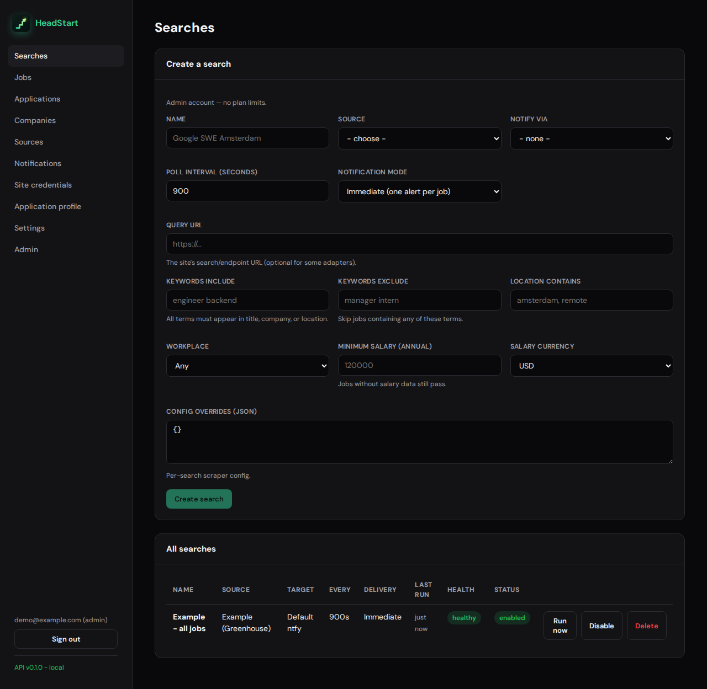
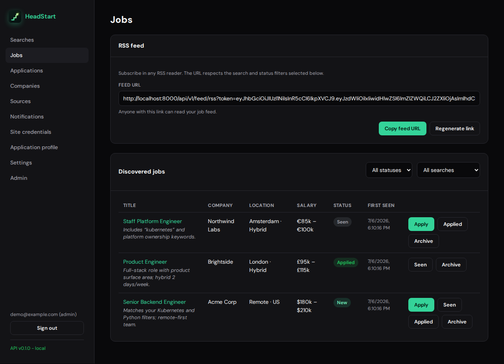
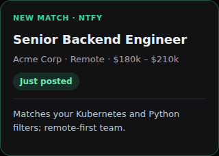
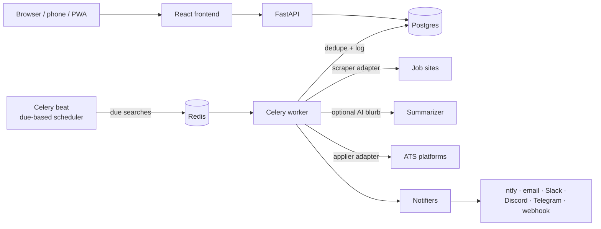

<div align="center">


# HeadStart

**Get notified the moment a new job matching your filters is posted, apply
before the crowd, and track every application through to the reply.**

[](LICENSE)


Job-site scrapers · multi-channel notifications · AI match summaries
(cloud or fully local) · auto-apply · application tracking

[Features](#features) · [Quick start](#quick-start-local) ·
[How it works](#how-it-works) · [Development](#development) ·
[Documentation](#documentation)

</div>

<p align="center">
  
  
</p>
<p align="center">
  
</p>

---

HeadStart is a modular, self-hostable, multi-user job-alert and auto-apply
platform. Configure **sources** (job sites), **searches** (URL + filters +
poll interval), and **notification targets** from a web UI. The backend polls
on a schedule, dedupes results, and pushes only **new** matching jobs to your
phone, desktop, inbox, or team chat. Where an apply adapter exists, it can
tailor your résumé, draft a cover letter, and submit the application for you.

It runs two ways from the **same images and code**:

- **Local (free):** one command brings up the whole stack with Docker Compose.
  No cloud account required.
- **AWS (opt-in):** the identical containers deploy to ECS Fargate via Terraform
  (`just aws-first-deploy` for a guided first deploy).

## Features

### Find

Each search polls on its own interval, applies keyword include/exclude,
location, remote/hybrid/onsite, and salary filters, dedupes against everything
already seen across searches, and notifies only on genuinely new hits.
Notifications deliver to ntfy push, email, Slack, Discord, Telegram, or custom
webhooks, immediately or in digest batches.

Scraper adapters cover Greenhouse, Lever, Ashby, Workday, SmartRecruiters,
iCIMS, Phenom, Workable, Rippling, SuccessFactors, Indeed, LinkedIn,
first-party big-tech careers boards, generic HTML, and Playwright-rendered
pages, and [adding one is a single file](#extending-headstart). New matches
land in an in-app feed with seen/applied/archived/closed status and signed RSS
export, and a catalog of employer career sites can be added to your watches in
one click (Pro accounts can keyword-search the catalog before subscribing).

### Apply

Store your application profile once and apply adapters submit programmatically
across the major ATS platforms. Every submit starts as a dry-run preview; live
submissions run on the worker queue with an audit log. Instead of attaching
the static file, HeadStart can generate a job-specific LaTeX résumé (compiled
to PDF in a locked-down sandbox) and a matching cover letter.

A dedicated view tracks every submission through `queued`, `awaiting_reply`,
`interview_pending`, `rejected`, `ghosted`, and `closed`, with attempt
timelines and stored artifacts. Site credentials are stored per user,
Fernet-encrypted, write-only in the API, and only decrypted at submit time.

### Understand

Each new match can carry a short AI summary of why it fits your search. The
providers are pluggable, including a
[fully local LLM via llama.cpp](#ai-cloud-or-fully-local), and the default
heuristic provider works offline with zero setup. Summaries, cover letters,
résumé curation, email classification, and reply drafting each pick their own
provider and model; Pro users can override the deployment default with their
own keys, which are encrypted at rest. Every AI path is best-effort with an
offline heuristic fallback, so a provider failure never blocks a notification,
and prompt-injection heuristics divert untrusted scraped or emailed text away
from the LLM entirely.

### Application agent (self-hosted, opt-in)

Behind `INBOX_AGENT_ENABLED`, HeadStart can work the half of the job hunt that
happens in your inbox. It is **not** for hosted multi-tenant deployments; see
[ADR 0011](docs/adr/0011-inbox-dev-only.md).

It connects to Gmail, Outlook, Yahoo, Fastmail, or generic IMAP/SMTP over
OAuth (PKCE + CSRF-bound state) or an API token. Recruiter mail tied to a
known application is labelled and filed into configured folders, and unrelated
mail never reaches a classifier. An application with no reply after a
configurable window is marked ghosted and summarized back to you; an interview
request flips the pipeline stage, fires a high-priority alert, then gets out
of the way. Drafted replies are previewable immediately and only auto-send
after a human-like delay, subject to rate caps, a sensitive-topic blocklist,
and recipient-domain checks.

### Platform

Accounts are isolated from each other in their sources, searches, targets, and
credentials, and the first account on a fresh install is admin. The jobs feed
installs as a mobile PWA for when push alone is not enough. Stripe
subscriptions for hosted tiers (Free / Starter / Plus / Pro, with promo codes)
are optional and disabled when the `STRIPE_*` env vars are unset. Prometheus
metrics cover scrape and notify health out of the box, and the public site
ships a landing page, pricing, legal pages, cookie consent, guided onboarding,
and GDPR export/delete for new accounts.

## Quick start (local)

Prerequisites: `just`, Docker + Docker Compose. Full toolchain list (and AWS
deploy tools) is in the [runbook](docs/runbook.md#prerequisites--toolchain).

```bash
cp .env.example .env          # pick an unguessable NTFY_DEFAULT_TOPIC
just up                       # api, worker, beat, db, redis, frontend
just migrate                  # apply database migrations
just seed                     # optional: demo account + example source
```

Then:

- Open <http://localhost:8080> for the public landing page, then
  **Create account** to start. The authenticated app lives under `/app/*`
  (e.g. `/app/searches`).
- API docs at <http://localhost:8000/docs>.
- Install the ntfy app on your phone and **subscribe to your topic**
  ([iOS](https://apps.apple.com/app/ntfy/id1625396347) /
  [Android](https://play.google.com/store/apps/details?id=io.heckel.ntfy)).

Step-by-step walkthrough: [getting-started guide](docs/getting-started.md).

Stop everything with `just down`. For fast iteration without Docker, use
`just dev` (needs local Postgres + Redis; see the [runbook](docs/runbook.md)).

## How it works



A `Search` is enqueued when it becomes due. A worker runs the matching scraper
adapter, applies filters, dedupes against previously seen jobs, optionally
generates a match summary, and delivers only new hits through the configured
notifier(s). See [architecture](docs/architecture.md).

The scheduler is due-based: if the stack goes down (say, a laptop lid closes),
missed windows collapse into a single catch-up run on restart rather than a
burst of requests to job sites. Because dedup is keyed on a seen-job hash,
downtime delays notifications but never drops or duplicates them.

## Extending HeadStart

Every cross-cutting subsystem is a plugin registry behind an abstract base
class. A new job site, channel, AI provider, apply flow, or mailbox is **one
self-registering file**, with no dispatch tables and no `if adapter == "x"`
chains:

| Extension point | Adapters include |
| --------------- | ---------------- |
| Scrapers | Greenhouse · Lever · Ashby · Workday · SmartRecruiters · iCIMS · Phenom · Workable · Rippling · SuccessFactors · Indeed · LinkedIn · Amazon · Apple · Google · Meta · Microsoft · IBM · Shopify · Snowflake · Uber · generic HTML · Playwright |
| Appliers | One per production scraper (everything except generic HTML and Playwright), including the careers boards above |
| Notifiers | ntfy · email · Slack · Discord · Telegram · webhook |
| AI families (summaries, cover letters, résumés, email classification, reply drafting) | heuristic · OpenAI · Gemini · Anthropic · llama.cpp |
| Mailbox connectors | IMAP/SMTP · Gmail · Outlook · Yahoo · Fastmail |

The real Greenhouse adapter, in its entirety of shape:

```python
@register_scraper("greenhouse")
class GreenhouseScraper(Scraper):
    """Fetch postings from a Greenhouse public job board."""

    def fetch(self, ctx: ScrapeContext) -> list[JobPosting]:
        ...
```

Exact steps for each adapter type: [recipes](docs/recipes.md).

## AI (cloud or fully local)

The same provider set backs every AI feature, and each purpose is configured
independently:

| Provider | Cost | Notes |
| -------- | ---- | ----- |
| `heuristic` | Free, offline | Default. Deterministic and built from your own data, so it is safe everywhere |
| `llamacpp` | Free, private | Local LLM via a llama.cpp `llama-server` (OpenAI-compatible); `just llamacpp` starts one |
| `openai` / `gemini` / `anthropic` | Your API key | Hosted, natural-language output |

Match summaries are generated after dedup and attached to notifications, the
jobs feed, and the RSS export. Every AI path is best-effort by design, so a
provider failure never blocks a notification or an application. Pro users can
override the deployment default per purpose with their own models and keys, and
stored keys are Fernet-encrypted at rest. Details:
[summaries module](docs/modules/summaries.md).

## Development

`just check` is the quality gate: `ruff` + `black` + `mypy` on the backend,
`eslint` + `tsc` + `prettier` on the frontend, and both test suites, run the
same way by CI on every push and pull request. Notable decisions are recorded
as [architecture decision records](docs/adr/), and every schema change is
captured as an Alembic migration that CI replays against a real Postgres.
Coding standards live in [docs/conventions.md](docs/conventions.md) and the
contributor rules in [AGENTS.md](AGENTS.md).

## Documentation

All project knowledge lives in [`docs/`](docs/README.md); start there. The
map is kept small so you only load what you need.

| Topic | Doc |
| ----- | --- |
| Documentation map | [docs/README.md](docs/README.md) |
| End-to-end user walkthrough | [docs/getting-started.md](docs/getting-started.md) |
| Deploy to AWS | [docs/deploying-to-aws.md](docs/deploying-to-aws.md) |
| System design | [docs/architecture.md](docs/architecture.md) |
| Per-module reference | [docs/modules/](docs/modules/) |
| Extension recipes | [docs/recipes.md](docs/recipes.md) |
| Coding standards | [docs/conventions.md](docs/conventions.md) |
| Run and debug | [docs/runbook.md](docs/runbook.md) |
| Why a decision was made | [docs/adr/](docs/adr/) |
| Roadmap | [docs/roadmap.md](docs/roadmap.md) |
| Contributor / agent rules | [AGENTS.md](AGENTS.md) |

## Repository layout

| Path | What lives here |
| ---- | --------------- |
| `backend/` | FastAPI API, Celery worker/scheduler, and the adapter families (scrapers, notifiers, appliers, summarizers, cover letters, résumés, email classifiers, reply drafters, mailboxes) |
| `frontend/` | React + TypeScript (Vite) web UI + PWA |
| `devops/` | Terraform for AWS deployment |
| `scripts/` | One script per operation (`just` delegates here) |
| `docs/` | Source-of-truth documentation |
| `.github/workflows/` | GitHub Actions. The CI quality gate runs on push/PR (`ci.yml`, lint/type/test); manual `deploy.yml` and `terraform.yml` add `fmt`/`validate` on PRs, with the credentialed plan manual-only. Both AWS-touching jobs stay dormant until `AWS_ROLE_ARN` (+ plan's `TF_STATE_BUCKET`) and secrets are configured |

## Common commands

Every operation has a script under `scripts/` and a `just` recipe. Run
bare `just` to see them all.

| Command | What it does |
| ------- | ------------ |
| `just up` / `just down` | Start / stop the Docker stack |
| `just dev` | Run API + frontend locally without Docker |
| `just check` | Lint, typecheck, and test (quality gate) |
| `just migrate` | Apply database migrations |
| `just aws-first-deploy` | Guided first-time AWS deploy |

## License

[Server Side Public License, version 1](LICENSE) (SSPL).

Third-party packages bundled in the container images are listed in
[`THIRD_PARTY_LICENSES.md`](THIRD_PARTY_LICENSES.md) (regenerate with
`just generate-third-party-licenses`). That file also documents the LGPL-3.0
`psycopg` / `psycopg-binary` source and relink affordance for self-hosters.
