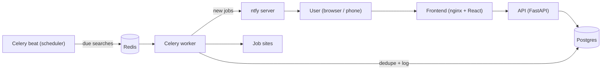

# Architecture

HeadStart polls job sites on a schedule, detects newly-posted jobs that match
your filters, and pushes them to your devices via ntfy.

## Components

| Component   | Tech                     | Responsibility                                        |
| ----------- | ------------------------ | ----------------------------------------------------- |
| Frontend    | React + TS (Vite), nginx | UI to manage sources, searches, targets; view jobs    |
| API         | FastAPI                  | CRUD over sources/searches/targets; serves job feed   |
| Scheduler   | Celery beat              | Enqueues searches that are **due** to run             |
| Worker      | Celery worker            | Runs scrapers, dedupes, sends notifications, logs      |
| Database    | Postgres                 | Persistent state                                      |
| Broker      | Redis                    | Celery task queue + result backend                    |
| Notifications | ntfy                   | Cross-platform push (iOS/Android/web/desktop)         |

## Request/data flow

## Core loop

1. **Scheduler tick** (every `SCHEDULER_TICK_SECONDS`): beat queries for searches
   where `next_run_at <= now` and `enabled = true`, and enqueues a task per
   search.
2. **Scrape**: the worker resolves the search's source `adapter_key`, runs the
   matching `Scraper`, and gets a list of normalized `JobPosting`s.
3. **Dedupe**: each posting is hashed; postings already in `seen_job` for that
   search are dropped. Only genuinely new ones continue.
4. **Notify**: new postings are sent through the search's `NotificationTarget`
   via the matching `Notifier` (ntfy by default).
5. **Record**: new postings are written to `seen_job`; deliveries are written to
   `delivery_log`; the search's `last_run_at`/`next_run_at` are updated.

## Resilient, due-based scheduling (catch-up)

The scheduler is **due-based**, not fire-and-forget. This matters because a
notifier's host may sleep or restart (e.g. running locally on a laptop).

- Each search stores `last_run_at` and a computed `next_run_at`.
- On every tick — and immediately on worker/beat startup — any search whose
  `next_run_at` is in the past is enqueued.
- Because dedup is based on `seen_job`, a missed window only **delays**
  notifications; it never drops or duplicates them.
- Because `next_run_at` is recomputed from *now* (not advanced once per missed
  interval), many missed intervals collapse into a single catch-up run, so
  coming back online after a long downtime does **not** trigger a burst of N
  requests to a site.

See [modules/worker.md](modules/worker.md) for the implementation.

## Modularity

Two extension points keep the system open/closed:

- **Scrapers** (`backend/app/scrapers/`): one adapter per site, self-registering
  in a registry. See [modules/scrapers.md](modules/scrapers.md).
- **Notifiers** (`backend/app/notifiers/`): one adapter per channel. See
  [modules/notifiers.md](modules/notifiers.md).

Adding either is a one-file change. The rest of the system addresses them only
through their abstract base class + registry.

## Run modes

The same images run in two environments:

- **Local:** `docker-compose.yml` orchestrates all services. Free, no cloud.
- **AWS:** ECS Fargate runs the identical containers; Terraform in `devops/`
  provisions RDS (Postgres), ElastiCache (Redis), ALB, and the services. See
  [modules/deployment.md](modules/deployment.md).
