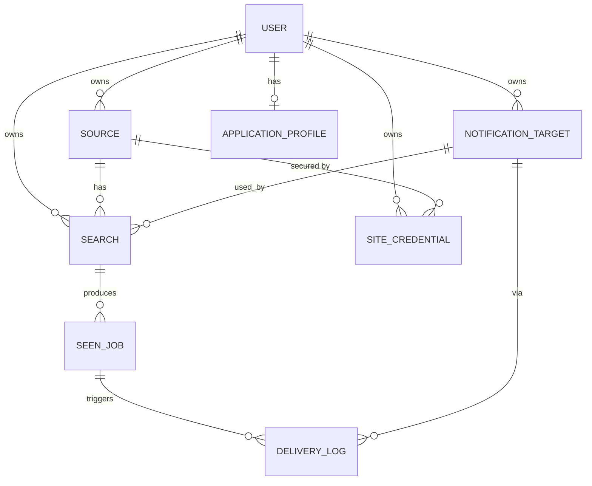

# Module: Data model

**Path:** `backend/app/models/`

Postgres via SQLAlchemy 2.0 (typed ORM) + Alembic migrations.

## Entities

**Ownership:** `source`, `search`, `notification_target`, `site_credential`,
`application_profile`, `application_artifact`, `promo_redemption`,
`promo_validation_attempt`, and the inbox/mailbox owned tables each carry a
`user_id` FK (`ON DELETE CASCADE`) and a matching `User` ORM relationship with
`cascade="all, delete-orphan"` so account erasure does not rely on the DB FK
alone (DAT-07 / DAT-12). `seen_job`, `delivery_log`, and `application_log` have
no `user_id`; they are scoped transitively through their parent `search`.
All API queries filter by the authenticated user — see [auth.md](auth.md).

### user

An account. The first one created becomes admin. Bootstrap promotion is
latched via `registration_lock.bootstrap_claimed` so deleting that first
admin cannot re-open self-service admin creation (see [auth.md](auth.md)).

| Column        | Type     | Notes                              |
| ------------- | -------- | ---------------------------------- |
| id            | int PK   |                                    |
| email         | str      | Unique, indexed                    |
| password_hash | str      | bcrypt                             |
| is_admin      | bool     | First registered user = true       |
| is_active     | bool     | Disabled accounts cannot log in    |
| feed_token_version | int | Incremented to revoke RSS feed URLs |
| token_version | int      | Incremented to revoke access/refresh JWTs (password reset, logout, admin deactivate) |
| onboarding_completed_at | datetime? | Set when the first-run wizard is finished or skipped |
| email_verified_at | datetime? | Set when the user confirms their email address |
| plan                  | str      | Subscription tier: `free`, `starter`, `plus`, or `pro` (default `free`) |
| stripe_customer_id    | str?     | Stripe customer ID (set on first checkout) |
| stripe_subscription_id | str?  | Active Stripe subscription ID |
| subscription_status   | str?     | Last known Stripe status (`active`, `trialing`, `canceled`, …) |
| stripe_billing_event_at | int?   | Unix `created` of last applied subscription webhook (stale-event guard) |
| summary_provider | str?  | Optional override for `SUMMARY_PROVIDER`; null uses the server default |
| summary_api_key_ciphertext | str? | Fernet-encrypted API key for the selected hosted provider |
| ai_purpose_providers | JSON? | Optional per-purpose provider overrides (`cover_letter`, `resume_curation`, …) |
| ai_purpose_models | JSON? | Optional per-purpose model overrides keyed by purpose id |
| created_at    | datetime |                                    |

### registration_lock

Singleton row (`id=1`) that serializes first-account bootstrap admin promotion.

| Column            | Type   | Notes |
| ----------------- | ------ | ----- |
| id                | int PK | Always `1` |
| bootstrap_user_id | int? FK → user | Set on claim; `ON DELETE SET NULL` (informational only) |
| bootstrap_claimed | bool   | Permanent latch; once `True`, never cleared by user deletion |

### email_verification_token

Single-use, time-limited token for email address verification.

| Column     | Type     | Notes                              |
| ---------- | -------- | ---------------------------------- |
| id         | int PK   |                                    |
| user_id    | FK user  | Owner; cascade delete              |
| token_hash | str      | SHA-256 via shared `hash_url_token` (unique) |
| expires_at | datetime |                                    |
| used_at    | datetime?| Set atomically on claim (DAT-18)   |
| created_at | datetime |                                    |

### password_reset_token

Single-use, time-limited token for email-based password reset.

| Column     | Type     | Notes                              |
| ---------- | -------- | ---------------------------------- |
| id         | int PK   |                                    |
| user_id    | FK user  | Owner; cascade delete              |
| token_hash | str      | SHA-256 via shared `hash_url_token` (unique) |
| expires_at | datetime |                                    |
| used_at    | datetime?| Set atomically on claim (DAT-18)   |
| created_at | datetime |                                    |

### source

A job site + which scraper handles it.

| Column          | Type      | Notes                                   |
| --------------- | --------- | --------------------------------------- |
| id              | int PK    |                                         |
| user_id         | FK user   | Owner                                   |
| name            | str       | Display name                            |
| adapter_key     | str       | Matches a registered scraper key        |
| base_url        | str       | Site base URL                           |
| default_config  | JSON      | Defaults merged into each search config |
| enabled         | bool      | Default true                            |
| auto_apply_enabled | bool   | Default false; must be true for live auto-apply |
| created_at      | datetime  |                                         |

### search

A saved query against a source, on an interval, delivering to a target.

| Column          | Type      | Notes                                          |
| --------------- | --------- | ---------------------------------------------- |
| id              | int PK    |                                                |
| user_id         | FK user   | Owner                                          |
| source_id       | FK source |                                                |
| name            | str       | e.g. "Google SWE Amsterdam"                        |
| query_url       | str       | The search URL/endpoint                        |
| filters         | JSON      | Post-scrape filters (see below)                |
| config          | JSON      | Per-search scraper config overrides            |
| interval_seconds| int       | Poll interval                                  |
| notification_mode | str     | `immediate` (default) or `digest`              |
| digest_interval_seconds | int | Batch window when mode is `digest` (default 3600) |
| target_id       | FK target | Where to notify                                |
| enabled         | bool      |                                                |
| last_run_at     | datetime? | Set after each run                             |
| last_digest_at  | datetime? | Set after each digest flush                    |
| last_error      | text?     | Most recent scrape failure message             |
| next_run_at     | datetime  | Drives due-based scheduling/catch-up           |

**`filters` JSON** — applied in the pipeline after scraping, before dedup:

| Key | Type | Behavior |
| --- | ---- | -------- |
| `keywords` / `keywords_include` | string or list | All terms must appear in title, company, or location (case-insensitive) |
| `keywords_exclude` | string or list | Exclude when any term appears in title, company, or location |
| `location` | string or list | Location field must contain any of the terms |
| `workplace` | string or list | `remote`, `hybrid`, or `onsite` — matches inferred workplace; unknown workplace passes |
| `min_salary` | number | Minimum annual salary when compensation is known; unknown or mismatched currency passes. Structured Ashby components with `MONTH`/`WEEK`/`DAY`/`HOUR` intervals are annualized (×12 / ×52 / ×260 / ×2080) before comparison; unknown intervals pass through unchanged. Text amounts accept US (`$88,500`, `$1,234.56`) and EU (`€55.000`, `1.234,56`) grouping/decimal separators (SVC-13) |
| `salary_currency` | string | ISO currency for `min_salary` (default `USD`) |

### seen_job

Dedup ledger; one row per unique job ever seen for a search. Notification
dedup is also applied across a user's searches by normalized job URL (see
[worker.md](worker.md)).

| Column        | Type        | Notes                                         |
| ------------- | ----------- | --------------------------------------------- |
| id            | int PK      |                                               |
| search_id     | FK search   |                                               |
| external_id   | str         | Site's id                                     |
| hash          | str         | Hash of normalized fields                     |
| title         | str         |                                               |
| company       | str         |                                               |
| location      | str         |                                               |
| salary        | str         | Formatted compensation when scraped (optional). Display uses `$`/`€`/`£` for USD/EUR/GBP; other ISO codes (e.g. CHF) are shown as the code prefix, and unknown currency omits a symbol rather than defaulting to `$` (SVC-14) |
| url           | str         |                                               |
| normalized_url| str         | Canonical form of `url` for cross-search dedup (DAT-05); written at insert |
| summary       | str         | "Why this matches" blurb (optional); see [summaries.md](summaries.md) |
| status        | str         | `new` / `seen` / `applied` / `archived` / `closed` |
| first_seen_at | datetime    |                                               |
| applied_at    | datetime    | Set when a live apply succeeds (manual or pipeline) |
| ghosted_at    | datetime?   | Set when ghost-detection leases a stale apply |
|               |             | **Unique (search_id, external_id)**           |
|               |             | **Index** `ix_seen_job_status_applied_at_unghosted` on `(status, applied_at)` where `ghosted_at IS NULL` (DAT-03 / DAT-14; ghost-detection claim) |
|               |             | **Index** `ix_seen_job_search_id_status` on `(search_id, status)` (DAT-11; job feed / applications status filters) |
|               |             | **Index** `ix_seen_job_normalized_url` on `normalized_url` (DAT-05; cross-search URL dedup) |

**`status` lifecycle:**

| Status | Set by | Meaning |
| ------ | ------ | ------- |
| `new` | Pipeline | First time this job was seen for the search |
| `seen` | User or pipeline | User acknowledged, or a previously closed listing reappeared |
| `applied` | User or apply pipeline | User applied, or auto-apply succeeded |
| `archived` | User | Hidden from active triage; not auto-closed on re-scrape |
| `closed` | Pipeline | Job no longer appears in scrape results (applied/archived rows are left alone). `SeenJobRepository.sync_after_scrape` applies this with two set-based `UPDATE`s (close missing `new`/`seen`, reopen matching `closed` → `seen`) rather than loading the full ledger into Python (DAT-16). |

### pending_digest

Jobs waiting to be included in the next batched digest notification for a search.
Enqueue (`PendingDigestRepository.add_many` / `DigestService.queue`) inserts the
batch with a single `flush` rather than one flush per job (SVC-15). After a
successful (or plan-skipped) flush, `PendingDigestRepository.delete_for_search`
clears the queue with a single bulk `DELETE … WHERE search_id = …` rather than
re-selecting and deleting ORM rows one-by-one.

| Column        | Type        | Notes                                         |
| ------------- | ----------- | --------------------------------------------- |
| id            | int PK      |                                               |
| search_id     | FK search   |                                               |
| seen_job_id   | FK seen_job | One queue row per job (**unique**)            |
| created_at    | datetime    | Used to anchor the first digest window        |

### notification_target

A delivery destination.

| Column   | Type    | Notes                                          |
| -------- | ------- | ---------------------------------------------- |
| id       | int PK  |                                                |
| user_id  | FK user | Owner                                          |
| name     | str     |                                                |
| type     | str     | Matches a registered notifier key (e.g. ntfy)  |
| config   | JSON    | e.g. `{server_url, topic, priority}`           |

### site_credential

Encrypted per-user, per-source secrets injected into scraper requests. See
[credentials.md](credentials.md).

| Column            | Type      | Notes                                       |
| ----------------- | --------- | ------------------------------------------- |
| id                | int PK    |                                             |
| user_id           | FK user   | Owner                                       |
| source_id         | FK source | Which source these credentials unlock       |
| name              | str       | Label                                       |
| secret_ciphertext | text      | Fernet-encrypted `{cookies, headers, session}` |
| enabled           | bool      | Only enabled creds are injected             |
| created_at        | datetime  |                                             |

### application_profile

Encrypted, per-user candidate profile for auto-apply (singleton per user). See
[profile.md](profile.md).

| Column          | Type      | Notes                                          |
| --------------- | --------- | ---------------------------------------------- |
| id              | int PK    |                                                |
| user_id         | FK user   | Owner; **unique** (one profile per user)       |
| data_ciphertext | text      | Fernet-encrypted JSON (contact, links, resume, cover-letter template, answers) |
| created_at      | datetime  |                                                |
| updated_at      | datetime  | Bumped on each save                            |

### delivery_log

Audit of notification attempts.

| Column      | Type        | Notes                          |
| ----------- | ----------- | ------------------------------ |
| id          | int PK      |                                |
| seen_job_id | FK seen_job |                                |
| target_id   | FK target   |                                |
| status      | str         | `sent` / `failed`              |
| error       | str?        | Present when failed            |
| sent_at     | datetime    |                                |
|             |             | **Index** `ix_delivery_log_status` on `status` (DAT-11; admin stats / failure counts) |

**Search-status top-N (DAT-04):** `DeliveryLogRepository.recent_failures_for_searches`
ranks failed rows with `ROW_NUMBER() PARTITION BY seen_job.search_id ORDER BY
sent_at DESC` and keeps only the newest N per search, so the searches list
endpoint does not load unbounded failure history into Python.

### application_log

Audit of auto-apply attempts (preview and live).

| Column                   | Type        | Notes                                    |
| ------------------------ | ----------- | ---------------------------------------- |
| id                       | int PK      |                                          |
| seen_job_id              | FK seen_job |                                          |
| status                   | str         | `queued` / `processing` / `submitted` / `dry_run` / `failed` (canonical: `APPLICATION_LOG_STATUSES` in `application_log.py`; DAT-09) |
| dry_run                  | bool        | True when the attempt was a preview only |
| error                    | text?       | Present when failed                      |
| payload                  | JSON?       | Scrubbed adapter body (SVC-11 drops `cookies`/`headers`/`authorization`/`session`/token keys) plus `employer_domain` + `posting` metadata for triage, and a `user_consent` stamp (`basis`, `mechanism`, `live_submission`, `recorded_at`) for each attempt |
| external_application_id  | str?        | Board-assigned ID on success             |
| created_at               | datetime    |                                          |

**Indexes (DAT-03):** `ix_application_log_dry_run_seen_job_id` on
`(dry_run, seen_job_id)` supports the applications-pipeline distinct subquery
that lists jobs with live (non–dry-run) apply activity.

**In-flight uniqueness (XCT-02 / SVC-01):** partial unique index
`uq_application_log_inflight_job` on `seen_job_id` where
`status IN ('queued', 'processing') AND dry_run IS FALSE`. Live enqueue
(`ApplicationLogRepository.try_add_pending`) inserts under a SAVEPOINT and
treats `IntegrityError` as “already in progress”, so concurrent
`POST /jobs/{id}/apply` or pipeline auto-apply cannot queue two Celery live
submits for the same job.

### document_generation

Ephemeral queue row for async resume / cover-letter generation (API-01).

| Column       | Type        | Notes                                              |
| ------------ | ----------- | -------------------------------------------------- |
| id           | int PK      |                                                    |
| user_id      | FK user     | Owner; cascade on delete                           |
| seen_job_id  | FK seen_job | Job being tailored; cascade on delete              |
| kind         | str         | `resume` or `cover_letter`                         |
| status       | str         | `queued` / `processing` / `ready` / `failed`       |
| error        | text?       | Present when failed                                |
| result       | JSON?       | Kind-specific payload when `ready`                 |
| created_at   | datetime    |                                                    |
| updated_at   | datetime    |                                                    |

### search_run

Ephemeral queue row for async manual `POST /searches/{id}/run` (API-02).

| Column       | Type        | Notes                                              |
| ------------ | ----------- | -------------------------------------------------- |
| id           | int PK      |                                                    |
| user_id      | FK user     | Owner; cascade on delete                           |
| search_id    | FK search   | Search being run; cascade on delete                |
| status       | str         | `queued` / `processing` / `ready` / `failed`       |
| error        | text?       | Present when the pipeline recorded an error        |
| result       | JSON?       | Count fields (`found`, `new`, `notified`, …)       |
| created_at   | datetime    |                                                    |
| updated_at   | datetime    |                                                    |

## Migrations

Change a model, then `just makemigration "..."`, review, `just migrate`.

Unit tests still build schema via SQLite `create_all` for speed. **Postgres
compatibility (TST-03)** is gated separately: CI's `migrations` job runs
`just test-migrations`, which boots disposable Postgres 16, applies
`alembic upgrade head` from an empty database, then `alembic check` so ORM
metadata cannot drift from the applied migrations. Irreversible data
migrations (plan rewrite, GDPR redaction) intentionally no-op `downgrade()`,
so a full downgrade-to-base round-trip is not part of the gate.

**Empty-string NOT NULL text columns (DAT-08):** when the ORM uses
`default=""` on a non-nullable text/string column, the Alembic migration must
also set `server_default=""` so raw SQL / tooling inserts that omit the column
succeed. `inbox_classification` (0024) and `inbox_reply_send_log` (0031 +
0045) follow this; do not leave the default ORM-only.
