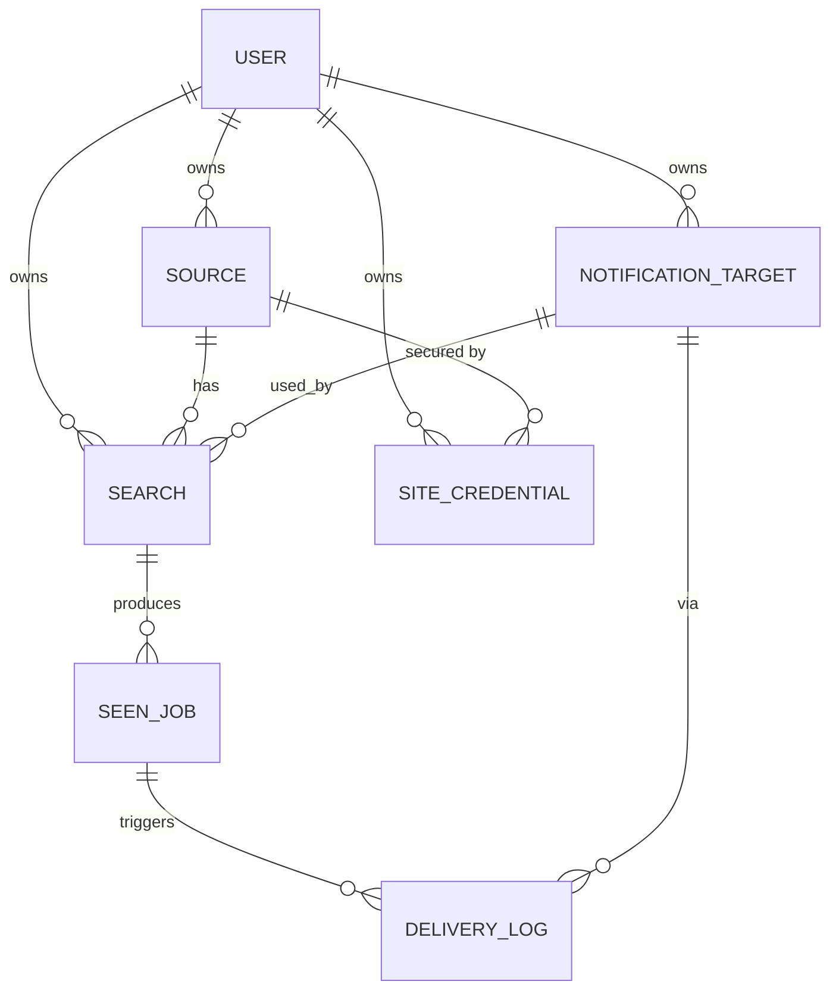

# Module: Data model

**Path:** `backend/app/models/`

Postgres via SQLAlchemy 2.0 (typed ORM) + Alembic migrations.

## Entities

**Ownership:** `source`, `search`, `notification_target`, and `site_credential`
each carry a `user_id` FK (`ON DELETE CASCADE`). `seen_job` and `delivery_log`
have no `user_id`; they are scoped transitively through their parent `search`.
All API queries filter by the authenticated user — see [auth.md](auth.md).

### user

An account. The first one created becomes admin.

| Column        | Type     | Notes                              |
| ------------- | -------- | ---------------------------------- |
| id            | int PK   |                                    |
| email         | str      | Unique, indexed                    |
| password_hash | str      | bcrypt                             |
| is_admin      | bool     | First registered user = true       |
| is_active     | bool     | Disabled accounts cannot log in    |
| created_at    | datetime |                                    |

### password_reset_token

Single-use, time-limited token for email-based password reset.

| Column     | Type     | Notes                              |
| ---------- | -------- | ---------------------------------- |
| id         | int PK   |                                    |
| user_id    | FK user  | Owner; cascade delete              |
| token_hash | str      | SHA-256 of the raw token (unique)  |
| expires_at | datetime |                                    |
| created_at | datetime |                                    |

### source

A job site + which scraper handles it.

| Column          | Type      | Notes                                   |
| --------------- | --------- | --------------------------------------- |
| id              | int PK    |                                         |
| user_id         | FK user   | Owner                                   |
| name            | str       | Display name                            |
| adapter_key     | str       | Matches a registered scraper key        |
| base_url        | str       | Site base URL                           |
| default_config  | JSON      | Defaults merged into each search config |
| enabled         | bool      | Default true                            |
| created_at      | datetime  |                                         |

### search

A saved query against a source, on an interval, delivering to a target.

| Column          | Type      | Notes                                          |
| --------------- | --------- | ---------------------------------------------- |
| id              | int PK    |                                                |
| user_id         | FK user   | Owner                                          |
| source_id       | FK source |                                                |
| name            | str       | e.g. "Google SWE Amsterdam"                        |
| query_url       | str       | The search URL/endpoint                        |
| filters         | JSON      | Post-scrape filters (see below)                |
| config          | JSON      | Per-search scraper config overrides            |
| interval_seconds| int       | Poll interval                                  |
| target_id       | FK target | Where to notify                                |
| enabled         | bool      |                                                |
| last_run_at     | datetime? | Set after each run                             |
| last_error      | text?     | Most recent scrape failure message             |
| next_run_at     | datetime  | Drives due-based scheduling/catch-up           |

**`filters` JSON** — applied in the pipeline after scraping, before dedup:

| Key | Type | Behavior |
| --- | ---- | -------- |
| `keywords` / `keywords_include` | string or list | All terms must appear in title, company, or location (case-insensitive) |
| `keywords_exclude` | string or list | Exclude when any term appears in title, company, or location |
| `location` | string or list | Location field must contain any of the terms |
| `workplace` | string or list | `remote`, `hybrid`, or `onsite` — matches inferred workplace; unknown workplace passes |

### seen_job

Dedup ledger; one row per unique job ever seen for a search. Notification
dedup is also applied across a user's searches by normalized job URL (see
[worker.md](worker.md)).

| Column        | Type        | Notes                                         |
| ------------- | ----------- | --------------------------------------------- |
| id            | int PK      |                                               |
| search_id     | FK search   |                                               |
| external_id   | str         | Site's id                                     |
| hash          | str         | Hash of normalized fields                     |
| title         | str         |                                               |
| company       | str         |                                               |
| location      | str         |                                               |
| url           | str         |                                               |
| first_seen_at | datetime    |                                               |
|               |             | **Unique (search_id, external_id)**           |

### notification_target

A delivery destination.

| Column   | Type    | Notes                                          |
| -------- | ------- | ---------------------------------------------- |
| id       | int PK  |                                                |
| user_id  | FK user | Owner                                          |
| name     | str     |                                                |
| type     | str     | Matches a registered notifier key (e.g. ntfy)  |
| config   | JSON    | e.g. `{server_url, topic, priority}`           |

### site_credential

Encrypted per-user, per-source secrets injected into scraper requests. See
[credentials.md](credentials.md).

| Column            | Type      | Notes                                       |
| ----------------- | --------- | ------------------------------------------- |
| id                | int PK    |                                             |
| user_id           | FK user   | Owner                                       |
| source_id         | FK source | Which source these credentials unlock       |
| name              | str       | Label                                       |
| secret_ciphertext | text      | Fernet-encrypted `{cookies, headers, session}` |
| enabled           | bool      | Only enabled creds are injected             |
| created_at        | datetime  |                                             |

### delivery_log

Audit of notification attempts.

| Column      | Type        | Notes                          |
| ----------- | ----------- | ------------------------------ |
| id          | int PK      |                                |
| seen_job_id | FK seen_job |                                |
| target_id   | FK target   |                                |
| status      | str         | `sent` / `failed`              |
| error       | str?        | Present when failed            |
| sent_at     | datetime    |                                |

## Migrations

Change a model, then `make makemigration m="..."`, review, `make migrate`.
