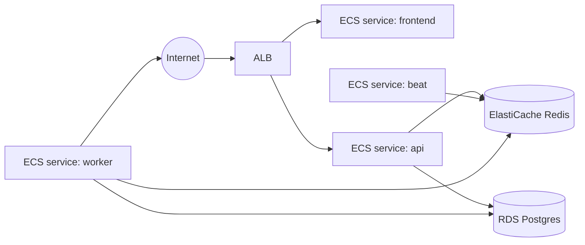

# Module: Deployment

**Path:** `devops/terraform/`

The same container images run locally (Docker Compose) and on AWS (ECS Fargate).
Local development never depends on anything in `devops/`.

## AWS topology



## Terraform layout

```
devops/terraform/
├── modules/
│   ├── network/   # VPC, subnets, security groups
│   ├── ecr/       # image repositories
│   ├── rds/       # Postgres
│   ├── redis/     # ElastiCache
│   ├── acm/       # DNS-validated TLS certificates (optional)
│   ├── alb/       # load balancer, listeners, target groups
│   ├── ecs/       # cluster, task defs + services (api, frontend, worker, beat)
│   ├── iam/       # task execution + task roles
│   └── secrets/   # Secrets Manager / SSM params
└── environments/
    ├── dev/
    └── prod/
```

State is remote: S3 bucket + DynamoDB lock table (configured per environment in
`backend.tf`). Secrets are stored in Secrets Manager / SSM and injected into ECS
task definitions — never in Terraform variables committed to git.

## HTTPS (optional)

By default the ALB serves HTTP on port 80 using its AWS-assigned DNS name. To
terminate TLS:

- Set `domain_name` + `route53_zone_id` in the environment module to provision
  ACM (DNS validation), an HTTPS listener on 443, HTTP→HTTPS redirect, and a
  Route53 alias to the ALB.
- Or pass a pre-validated `acm_certificate_arn` in the same region as the ALB.

`app_url` and `CORS_ORIGINS` default to `https://<domain>` when HTTPS is
enabled. See [deploying-to-aws.md](../deploying-to-aws.md#custom-domain--https).

## Worker sizing (Playwright)

The worker service uses a separate container image (`jobnotifier-backend-worker`)
with Chromium pre-installed. Default Fargate sizing is **1024 CPU / 2048 MiB**
(vs **256 / 512** for api, beat, and frontend). Override via stack module vars
`worker_cpu` and `worker_memory` in `environments/<env>/main.tf`.

## Observability

Prometheus metrics are exposed from two scrape targets:

- **API** service: `GET /metrics` on port 8000 (synchronous pipeline runs).
- **Worker** service: `GET /metrics` on `METRICS_PORT` (default 9090).

See [modules/metrics.md](../modules/metrics.md) for metric names, PromQL examples,
and optional `METRICS_TOKEN` auth. On AWS, add the worker metrics port to the task
security group and scrape with Prometheus or the CloudWatch agent.

## Deploy flow

`make deploy` (→ `scripts/deploy.sh`). Load deploy env vars with
`eval "$(make aws-deploy-env)"` (reads Terraform outputs for `ECR_REGISTRY`,
`ECS_CLUSTER`, `APP_URL`, etc.).

**First-time deploy:** `make aws-first-deploy PREFIX=yourname` chains state
bootstrap, `terraform apply`, and `make deploy` — see
[deploying-to-aws.md](../deploying-to-aws.md#quick-start-one-command).

1. Build images (`scripts/build-images.sh`): lean `jobnotifier-backend` (api/beat)
   and `jobnotifier-backend-worker` (Playwright + Chromium).
2. Push to ECR.
3. Run DB migrations as a one-off ECS task.
4. Update ECS services to the new image tag (rolling deploy).

CI runs the quality gate on every push/PR; the AWS workflows
run `terraform plan` on PRs and (gated) `terraform apply` + `make deploy` on
merge to main.

## First-time setup

See **[deploying-to-aws.md](../deploying-to-aws.md)** for the full walkthrough
(prerequisites, state bootstrap, `terraform apply`, `make deploy`, verification).

Summary:

1. Bootstrap S3 state + DynamoDB lock (`environments/<env>/backend.tf`).
2. `terraform init && terraform apply` in `environments/dev` (or `prod`).
3. `make deploy` with `ECR_REGISTRY` and `ECS_CLUSTER` set.
4. Optional: configure AWS/GitHub secrets so the deploy/terraform workflows can run.
