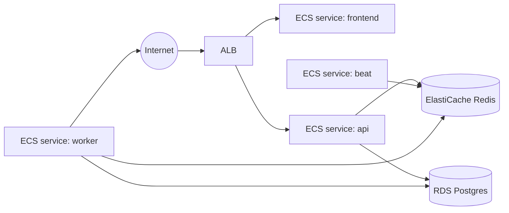

# Module: Deployment

**Path:** `devops/terraform/`

The same container images run locally (Docker Compose) and on AWS (ECS Fargate).
Local development never depends on anything in `devops/`.

## Backend dependency lockfiles

Runtime (and optional `dev` / `playwright`) dependencies are pinned with hashes
in `backend/requirements.txt`, `requirements-dev.txt`, and
`requirements-playwright.txt` (pip-tools; see
[ADR-0012](../adr/0012-backend-dependency-lockfiles.md)). The Dockerfile and CI
install with `pip install --require-hashes -r …`, then install the local package
with `--no-deps`. **Layer order (OPS-28):** `backend/Dockerfile` copies only
`pyproject.toml` + `requirements.txt` for the hashed deps `RUN`, then
`COPY app` and `pip install --no-deps .`, so application source edits do not
bust the third-party dependency layer. Regenerate via `just lock-backend`
after editing `backend/pyproject.toml` dependency floors.

**Floors must match tested majors (XCT-23).** `pyproject.toml` `>=` floors are
the human-readable support contract. Keep them aligned with the majors already
pinned in the lockfiles (and exercised by CI) — for example `celery>=5.6`,
`redis>=6.0`, `httpx>=0.28`, `cryptography>=49.0`, `stripe>=15.0`. Do not leave
floors on older majors the suite never runs against.

**Dependency CVE scanning (OPS-19).** CI runs `just audit-backend` after the
dev install (`pip-audit --disable-pip` against the three hashed lockfiles).
`pip-audit` is a `[dev]` extra. Dependabot watches `/backend` weekly alongside
the frontend npm ecosystem. Locally: `just audit-backend` (needs
`./scripts/install-backend.sh --dev`).

## AWS topology



## Terraform layout

```
devops/terraform/
├── modules/
│   ├── network/   # VPC, subnets, NAT, VPC flow logs → CloudWatch
│   ├── ecr/       # image repositories
│   ├── rds/       # Postgres (CMK, IAM auth, PI, log exports, EM — OPS-43)
│   ├── redis/     # ElastiCache
│   ├── acm/       # DNS-validated TLS certificates (optional)
│   ├── alb/       # load balancer, listeners, target groups, access logs, WAF
│   ├── ecs/       # cluster, task defs + services (api, frontend, worker, beat)
│   ├── iam/       # task execution + task roles
│   └── secrets/   # Secrets Manager (CMK + recovery window — OPS-51)
└── environments/
    ├── beta/
    └── prod/
```

**Module provider floors (OPS-40).** Every reusable module under `modules/*`
ships a `versions.tf` with `required_version >= 1.5.0` and
`required_providers` for `hashicorp/aws >= 5.60` (the stack module also pins
`hashicorp/random >= 3.6` for `random_password`). Environment roots still own
the exact `~>` constraint; modules declare the compatibility floor so a caller
without a pin fails fast instead of binding an incompatible provider.

State is remote: S3 bucket + DynamoDB lock table. Each environment's
`backend.tf` is a **partial** config (state `key`, region, lock table,
encryption); the bucket is supplied at `terraform init` via
`-backend-config` / `backend.hcl` so a real bucket name is never committed
(OPS-29). Secrets are stored in Secrets Manager / SSM and injected into ECS
task definitions — never in Terraform variables committed to git. Core apply
secrets (`db_password`, `jwt_secret`, `credentials_secret_key`) are supplied
only via `TF_VAR_*` env vars; beta/prod `terraform.tfvars.example` files no
longer show inline assignments for them so operators are not primed to paste
real secrets into a local `terraform.tfvars` (OPS-33).

## HTTPS (required in prod)

**Beta** may serve HTTP on port 80 using the ALB's AWS-assigned DNS name (useful
for throwaway stacks). **Prod** refuses that path: the stack `check
"prod_requires_https"` fails plan/apply unless TLS is configured, so auth and
site-credential API traffic cannot ride cleartext on the public ALB (OPS-36).

To terminate TLS:

- Set `domain_name` + `route53_zone_id` in the environment module to provision
  ACM (DNS validation), an HTTPS listener on 443, HTTP→HTTPS redirect, and a
  Route53 alias to the ALB.
- Or pass a pre-validated `acm_certificate_arn` in the same region as the ALB.

`app_url`, `CORS_ORIGINS`, and `FRONTEND_BASE_URL` default to `https://<domain>`
when HTTPS is enabled. `AUTH_COOKIE_SECURE` is derived the same way (`true` when
`https_enabled`, otherwise `false`) so the refresh cookie is not dropped on a
beta HTTP ALB. Outside `local`/`test`, the API also refuses to boot when
`AUTH_COOKIE_SECURE=true` is paired with a non-`https` `FRONTEND_BASE_URL`, or
when `AUTH_COOKIE_SAMESITE=none` is set without Secure (AUT-13). Optional
`smtp_*` variables configure transactional email (`SMTP_PASSWORD` in Secrets
Manager). `ntfy_default_topic` is **required** (no Terraform default): ntfy.sh
topics are public by name, so beta/prod reject empty or `change-me` placeholders
and the app refuses the same guessable default outside `local`/`test` (OPS-16).
See [deploying-to-aws.md](../deploying-to-aws.md#custom-domain--https) and
[launch-checklist.md](../launch-checklist.md).

## Worker sizing (Playwright)

The worker service uses a separate container image (`headstart-backend-worker`)
with Chromium pre-installed. Default Fargate sizing is **1024 CPU / 2048 MiB**
(vs **256 / 512** for api, beat, and frontend). Override via stack module vars
`worker_cpu` and `worker_memory` in `environments/<env>/main.tf`.

### Chromium sandbox & seccomp (OPS-27)

The worker scrapes untrusted employer sites inside Chromium. Hardening:

- **Process sandbox:** `playwright_browser` launches Chromium **without**
  `--no-sandbox` by default. `PLAYWRIGHT_NO_SANDBOX=true` is a local/test-only
  escape hatch and is rejected at boot outside those environments.
- **ECS:** the worker task definition sets `linuxParameters.seccompProfile.type
  = RuntimeDefault`, drops all Linux capabilities, and enables the container
  init process so orphaned Chromium children are reaped.
- **Image:** `backend/Dockerfile` target `worker` installs Playwright/Chromium
  as root (system deps), then runs as `appuser`.

### Container hardening (OPS-38)

Every ECS task definition (api, worker, beat, frontend, and the one-off
migrate) pins defense-in-depth beyond the image `USER`:

- **Non-root `user`:** backend roles `10001:10001` (`appuser`), frontend
  `101:101` (nginx-unprivileged).
- **`readonlyRootFilesystem = true`** with `linuxParameters.tmpfs` on `/tmp`
  (worker gets 512 MiB for Chromium scratch; frontend also mounts
  `/var/cache/nginx` and `/var/run`). Beat writes
  `--schedule=/tmp/celerybeat-schedule` so the schedule file is not on `/app`.
- **Container `healthCheck`:** api probes `/api/v1/health`; worker accepts
  `/metrics` 200 or 401 (token always set — OPS-54); beat checks a live
  `celery … beat` cmdline under `/proc`; frontend `wget`s `:8080/`. Migrate
  omits a probe (one-shot).
- **`linuxParameters`:** all roles use `RuntimeDefault` seccomp, drop all
  capabilities, and enable container init (worker already did this for
  OPS-27).

## Distinct VPC CIDRs (OPS-30)

Beta and prod must not share the same private address space. Each environment's
`main.tf` sets `vpc_cidr` / subnet CIDRs explicitly:

| Environment | VPC CIDR | Public subnets | Private subnets |
| ----------- | -------- | -------------- | --------------- |
| beta | `10.20.0.0/16` | `10.20.0.0/24`, `10.20.1.0/24` | `10.20.10.0/24`, `10.20.11.0/24` |
| prod | `10.30.0.0/16` | `10.30.0.0/24`, `10.30.1.0/24` | `10.30.10.0/24`, `10.30.11.0/24` |

Stack module defaults stay on the beta range for backwards-compatible local
module calls; env wrappers own the real pin. `TRUSTED_PROXY_CIDRS` follows
`var.vpc_cidr`, so ALB-trusted XFF stays aligned with each env's VPC.

**Existing prod stacks** that already applied the old shared `10.20.0.0/16`
will see a VPC replacement on the next apply — plan carefully (or leave the
live CIDR and only use `10.30` for greenfield prod).

## AWS account pin (OPS-31)

Beta and prod providers set `allowed_account_ids = [var.aws_account_id]`.
`aws_account_id` is **required** (no default) and must be a 12-digit AWS
account ID. A plan/apply with ambient credentials for a different account
fails at provider initialization instead of provisioning into the wrong
account. Prefer:

```bash
export TF_VAR_aws_account_id="$(aws sts get-caller-identity --query Account --output text)"
```

`scripts/aws-first-deploy.sh` resolves the caller account when unset and
persists it to `.aws-first-deploy-secrets.env` so later runs keep the pin.

## Prod resilience knobs (OPS-05 / OPS-08 / OPS-10)

`environments/prod/main.tf` raises durability beyond the stack defaults that
`beta` keeps:

| Knob | Stack default (beta) | Prod |
| ---- | -------------------- | ---- |
| `db_multi_az` / `db_deletion_protection` | false | true |
| `db_skip_final_snapshot` | true (beta only) / false (stack default) | false (enforced) |
| `alb_deletion_protection` | false | true |
| `db_backup_retention_days` | 7 | 30 |
| `log_retention_days` (ECS + VPC flow logs) | 30 | 90 |
| `redis_automatic_failover` | false (1-node replication group) | true (Multi-AZ, 2 nodes) |

`backup_retention_days` and `log_retention_days` are plumbed through the stack
module into `rds` / `ecs` / `network` (VPC flow logs). Redis is always an
`aws_elasticache_replication_group` (required for in-transit encryption) with
`transit_encryption_enabled`, `at_rest_encryption_enabled` (AWS-managed KMS by
default; optional `kms_key_id`), and an AUTH token from `random_password` stored
in Secrets Manager as `REDIS_PASSWORD`. ECS tasks get `REDIS_TLS=true` and the
password secret so Celery builds `rediss://` broker/result URLs with
`ssl_cert_reqs=required` (OPS-10).
Enabling encryption/AUTH on an existing unencrypted broker replaces the
resource (brief Celery downtime on apply). Prod also requires an explicit
immutable `image_tag` (git SHA): there is no `"latest"` default, and Terraform
rejects `latest` so a task recycle cannot silently pull a different build
(OPS-07). ECR repositories set `image_tag_mutability = "IMMUTABLE"` so a
re-push cannot overwrite a tag that task definitions still reference (OPS-09).
Ongoing rolls still retarget task defs via `deploy.sh` / `IMAGE_TAG`.

### VPC flow logs (OPS-41)

Every environment's VPC publishes **ALL** traffic flow logs to CloudWatch Logs
(`/vpc/{name}/flow-logs`) via a dedicated IAM role assumed by
`vpc-flow-logs.amazonaws.com`. Retention follows `log_retention_days` (30 on
beta, 90 on prod) so accepted/rejected ENI traffic to tasks/RDS/Redis is
available for incident response without changing the data plane.

### RDS datastore hardening (OPS-43)

Every environment's Postgres instance:

- Encrypts storage (and Performance Insights) with a **customer-managed KMS
  key** (`alias/{name}-rds`) that has annual key rotation enabled — not the
  shared `aws/rds` key
- Enables **IAM database authentication** (password auth still works; operators
  can add IAM-mapped DB users as a second factor)
- Turns on **Performance Insights** (7-day retention by default) and
  **Enhanced Monitoring** (60s interval via a dedicated IAM role)
- Exports `postgresql` + `upgrade` logs to CloudWatch Logs
- Defaults `apply_immediately = false` so engine/parameter changes wait for the
  maintenance window instead of rebooting mid-apply

### RDS destroy safety (OPS-48)

`skip_final_snapshot` is a **separate** knob from `deletion_protection` (it used
to be `!deletion_protection`, so a forgotten protection override also skipped
the final snapshot). The RDS module defaults `skip_final_snapshot = false` and
sets `final_snapshot_identifier = "{name}-final"` when a snapshot is kept.
Beta opt-in sets `db_skip_final_snapshot = true` for throwaway teardown; prod
keeps the default. Stack `check "prod_requires_db_deletion_protection"` fails
plan/apply unless `environment=prod` has `db_deletion_protection=true` **and**
`db_skip_final_snapshot=false`.

**Existing stacks** that already applied AWS-managed storage encryption will
see an RDS replacement when adopting the CMK — plan a snapshot / restore
window before apply.

### Secrets Manager CMK + recovery window (OPS-51)

Application secrets (`JWT_SECRET`, `CREDENTIALS_SECRET_KEY`,
`POSTGRES_PASSWORD`, `REDIS_PASSWORD`, `METRICS_TOKEN`, optional
`SMTP_PASSWORD`) are encrypted with a **customer-managed KMS key**
(`alias/{name}-secrets`) that has annual key rotation enabled — not the shared
`aws/secretsmanager` key. The key policy allows use only via Secrets Manager
(`kms:ViaService`) for principals in the account. Each secret sets an explicit
`recovery_window_in_days` (default **30**). The ECS task execution role is
granted `kms:Decrypt` / `kms:DescribeKey` on that CMK alongside
`secretsmanager:GetSecretValue`.

Adopting the CMK on an existing stack re-encrypts secret material in place (no
secret replacement); schedule the apply during a quiet window and confirm tasks
still pull secrets after the roll.

### ALB hardening (OPS-08)

Every environment's ALB (beta and prod) enables:

- `drop_invalid_header_fields = true` (reject request-smuggling via malformed headers)
- S3 access logs (`{name}-alb-access-logs-{account}`) with a 90-day lifecycle
- A regional WAFv2 web ACL (AWS Managed Common + Known Bad Inputs rule groups)

Prod additionally sets `alb_deletion_protection = true` so a fat-finger
`terraform destroy` cannot delete the public entrypoint. Beta keeps deletion
protection off so throwaway stacks can tear down cleanly (the access-logs
bucket uses `force_destroy` when deletion protection is off).

### Tasks SG from ALB (OPS-14)

The shared ECS tasks security group accepts ingress from the ALB SG only on the
two target-group ports: **8080** (frontend, unprivileged nginx) and **8000**
(api). A prior `0–65535` rule would also have exposed the worker metrics port
(`9090`) to any member of the ALB SG. Worker/beat have no ALB targets; scrape
them from a dedicated Prometheus/CloudWatch agent security group, not via the
ALB rule.

## Observability

Prometheus metrics are exposed from two scrape targets:

- **API** service: `GET /metrics` on port 8000 (synchronous pipeline runs).
- **Worker** service: `GET /metrics` on `METRICS_PORT` (default 9090).

See [modules/metrics.md](../modules/metrics.md) for metric names, PromQL examples,
and `METRICS_TOKEN` Bearer auth (honored by both API and worker scrape targets).
Terraform always stores a generated `METRICS_TOKEN` in Secrets Manager and injects
it into ECS tasks (OPS-54), so AWS scrapes must send `Authorization: Bearer`.
On AWS, open worker `:9090` from your scraper security group (not the ALB SG;
see OPS-14 above) and scrape with Prometheus or the CloudWatch agent.

## Deploy flow

`just deploy` (→ `scripts/deploy.sh`). Load deploy env vars with
`eval "$(just aws-deploy-env)"` (reads Terraform outputs for `ECR_REGISTRY`,
`ECS_CLUSTER`, `APP_URL`, etc.). `aws-deploy-env.sh` emits each value with
`printf %q` so a terraform/aws output containing a single quote or other
shell metacharacters cannot break the `eval`'d string (OPS-62; previously a
single-quoted heredoc).

**First-time deploy:** `just aws-first-deploy PREFIX=yourname` chains state
bootstrap, `terraform apply`, and `just deploy` — see
[deploying-to-aws.md](../deploying-to-aws.md#quick-start-one-command).

1. Build images (`scripts/build-images.sh`): lean `headstart-backend` (api/beat)
   and `headstart-backend-worker` (Playwright + Chromium).
2. Push to ECR under tag `IMAGE_TAG` (git short SHA by default; CI uses the full
   commit SHA).
3. Resolve each pushed image's ECR content digest (`describe-images` →
   `imageDigest`) for `headstart-backend`, `headstart-backend-worker`, and
   `headstart-frontend`.
4. Register a new `headstart-migrate` task-definition revision whose container
   image is pinned to `:{IMAGE_TAG}@{sha256:…}` (not tag alone), then run
   migrations as a one-off ECS task. `deploy.sh` waits for the task to stop and
   requires every container `exitCode == 0` before continuing — a failed or
   still-running migration aborts the deploy so new app images never roll
   against a bad schema (OPS-17).
5. For each long-running service (`api`, `frontend`, `worker`, `beat`), register
   a new task-definition revision pinned to the same `tag@digest` (via
   `python -m app.cli.ecs_task_def retarget --image-digest …`) and
   `update-service --task-definition <new-arn> --force-new-deployment`.

ECS services use `lifecycle { ignore_changes = [task_definition] }` so Terraform
keeps the initial wiring while `deploy.sh` owns the image pin at roll time.
Force-new-deployment alone is not enough when the task def still points at a
tag the build never re-pushes (historically Terraform's `image_tag = "latest"`;
prod now requires an immutable SHA pin — OPS-07). `deploy.sh` registers a new
revision pinned to `IMAGE_TAG` before rolling (OPS-01), and further pins that
revision to the ECR content digest resolved after push (OPS-64) so the rolled
task cannot pull a different manifest than this pipeline built — even if a tag
were ever mutable again.

All workflows live in `.github/workflows/`. The CI quality gate (`ci.yml`) runs
on push/PR via the same `scripts/check.sh` entrypoint as local `just check`
(OPS-22): backend `just check --backend` (ruff + black + LOC, mypy, pytest) and
`just check --scripts` (shell syntax + shellcheck `-S warning`, OPS-65); frontend `just check --frontend`
(eslint + prettier `--check`, tsc, vitest) plus `just build-frontend`. Audits
stay adjacent: `just audit-backend` (`pip-audit` on hashed lockfiles, OPS-19)
and `just audit-frontend` (`npm audit --audit-level=high`, FRO-12). Every
third-party `uses:` is pinned to a full commit SHA with a version comment
(OPS-20) so a re-pointed `@vN` tag cannot silently change the job; Dependabot
opens weekly PRs for those SHAs, for `frontend/package-lock.json`, and for
backend pip (`.github/dependabot.yml`). On push failures, a `notify` job posts
to Slack when `secrets.SLACK_WEBHOOK_URL` is set — the webhook is mapped at
**job** level so the step `if: env.SLACK_WEBHOOK_URL != ''` can see it
(OPS-21; step-level `env` is not available to that same step's `if`). Local
pre-commit is a **fast subset** of that gate (whitespace/yaml, ruff/black,
eslint, prettier, LOC, shell validation) — types, tests, coverage, and
dependency audits stay in `just check` / CI. The `frontend-lint` hook runs
`npx eslint . --max-warnings=0` (same as `npm run lint`) so ESLint always
receives an explicit path — without one, ESLint 8 scans zero files and exits
0 (OPS-03). LOC, shell validation, and prettier are enforced in both
pre-commit and CI (OPS-04). Shell validation runs `bash -n` then `shellcheck
-x -S warning` on every `scripts/*.sh` (OPS-65; CI installs `shellcheck` before
that step). The LOC gate prints offender paths with a literal
repo-root strip so glob metacharacters in the checkout path cannot garble the
report (OPS-63). `deploy.yml` (manual `workflow_dispatch`) and `terraform.yml`'s credentialed
`plan` job are guarded on `vars.AWS_ROLE_ARN` (plus default-branch refs), so
they stay dormant until AWS is configured. `terraform.yml` still runs
`fmt`/`validate` on `devops/terraform/**` PRs **without** secrets or OIDC
(OPS-24); credentialed `terraform plan` is manual-only from `main`/`master`.

**Deploy OIDC hardening (OPS-23).** `deploy.yml` assumes `AWS_ROLE_ARN` only
when `github.ref` is `refs/heads/main` or `refs/heads/master`, sets OIDC
`audience: sts.amazonaws.com` and a `role-session-name` of
`headstart-deploy-<run_id>`, and targets the GitHub Environment named by the
workflow input (`beta` / `prod` — enable required reviewers there). The IAM
trust policy for that role **must** pin
`token.actions.githubusercontent.com:sub` to
`repo:<owner>/<repo>:ref:refs/heads/main` (or `master`), not a wildcard
`repo:…:*`. Protect `main`/`master` with branch protection so only reviewed
commits are dispatchable from those refs.

**Terraform plan trust (OPS-24).** `terraform.yml` never injects
`TF_VAR_*` secrets or assumes AWS on `pull_request` checkouts (a same-repo
branch could otherwise exfiltrate them via plan-time provider/data-source
code). The credentialed `plan` job is `workflow_dispatch` only, requires
`refs/heads/main|master`, uses the `beta`/`prod` GitHub Environment, OIDC
(`audience` + `role-session-name: headstart-tf-plan-<run_id>`), and
`vars.TF_STATE_BUCKET` for remote-state init (OPS-29 partial backend).

## First-time setup

See **[deploying-to-aws.md](../deploying-to-aws.md)** for the full walkthrough
(prerequisites, state bootstrap, `terraform apply`, `just deploy`, verification).

Summary:

1. Bootstrap S3 state + DynamoDB lock, then
   `terraform init -backend-config=…` (bucket not in committed `backend.tf`;
   OPS-29).
2. `terraform apply` in `environments/beta` (or `prod`).
3. `just deploy` with `ECR_REGISTRY` and `ECS_CLUSTER` set.
4. Optional: activate the deploy/terraform workflows by setting the
   `AWS_ROLE_ARN` and `TF_STATE_BUCKET` repo variables and the AWS/GitHub
   secrets (the workflow files are already in place). Pin the IAM OIDC trust
   `sub` to `main`/`master`, enable Environment reviewers, and keep branch
   protection (OPS-23 / OPS-24).
