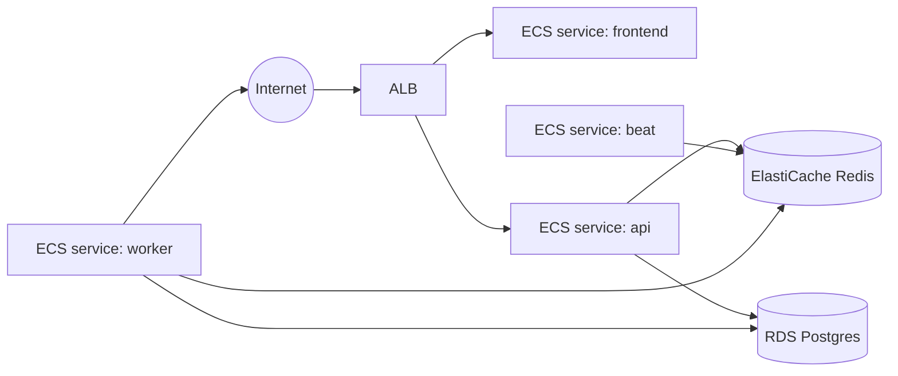

# Module: Deployment

**Path:** `devops/terraform/`

The same container images run locally (Docker Compose) and on AWS (ECS Fargate).
Local development never depends on anything in `devops/`.

## AWS topology



## Terraform layout

```
devops/terraform/
├── modules/
│   ├── network/   # VPC, subnets, security groups
│   ├── ecr/       # image repositories
│   ├── rds/       # Postgres
│   ├── redis/     # ElastiCache
│   ├── alb/       # load balancer, listeners, target groups
│   ├── ecs/       # cluster, task defs + services (api, frontend, worker, beat)
│   ├── iam/       # task execution + task roles
│   └── secrets/   # Secrets Manager / SSM params
└── environments/
    ├── dev/
    └── prod/
```

State is remote: S3 bucket + DynamoDB lock table (configured per environment in
`backend.tf`). Secrets are stored in Secrets Manager / SSM and injected into ECS
task definitions — never in Terraform variables committed to git.

## Deploy flow

`make deploy` (→ `scripts/deploy.sh`):

1. Build images (`scripts/build-images.sh`).
2. Push to ECR.
3. Run DB migrations as a one-off ECS task.
4. Update ECS services to the new image tag (rolling deploy).

CI runs `terraform plan` on PRs and (gated) `terraform apply` on merge to main.
See [.github/workflows](../../.github/workflows).

## First-time setup

1. Create the S3 state bucket + DynamoDB lock table (one-time, documented in
   `environments/<env>/backend.tf`).
2. `terraform init && terraform apply` in `environments/dev`.
3. Configure GitHub Actions secrets (AWS role to assume, Slack webhook).
