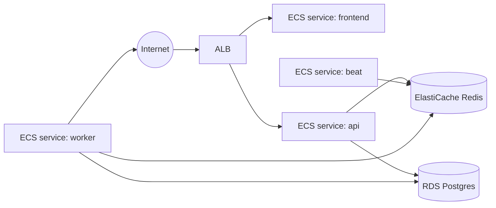

# Module: Deployment

**Path:** `devops/terraform/`

The same container images run locally (Docker Compose) and on AWS (ECS Fargate).
Local development never depends on anything in `devops/`.

## Backend dependency lockfiles

Runtime (and optional `dev` / `playwright`) dependencies are pinned with hashes
in `backend/requirements.txt`, `requirements-dev.txt`, and
`requirements-playwright.txt` (pip-tools; see
[ADR-0012](../adr/0012-backend-dependency-lockfiles.md)). The Dockerfile and CI
install with `pip install --require-hashes -r …`, then install the local package
with `--no-deps`. Regenerate via `just lock-backend` after editing
`backend/pyproject.toml` dependency floors.

## AWS topology



## Terraform layout

```
devops/terraform/
├── modules/
│   ├── network/   # VPC, subnets, security groups
│   ├── ecr/       # image repositories
│   ├── rds/       # Postgres
│   ├── redis/     # ElastiCache
│   ├── acm/       # DNS-validated TLS certificates (optional)
│   ├── alb/       # load balancer, listeners, target groups
│   ├── ecs/       # cluster, task defs + services (api, frontend, worker, beat)
│   ├── iam/       # task execution + task roles
│   └── secrets/   # Secrets Manager / SSM params
└── environments/
    ├── beta/
    └── prod/
```

State is remote: S3 bucket + DynamoDB lock table (configured per environment in
`backend.tf`). Secrets are stored in Secrets Manager / SSM and injected into ECS
task definitions — never in Terraform variables committed to git.

## HTTPS (optional)

By default the ALB serves HTTP on port 80 using its AWS-assigned DNS name. To
terminate TLS:

- Set `domain_name` + `route53_zone_id` in the environment module to provision
  ACM (DNS validation), an HTTPS listener on 443, HTTP→HTTPS redirect, and a
  Route53 alias to the ALB.
- Or pass a pre-validated `acm_certificate_arn` in the same region as the ALB.

`app_url`, `CORS_ORIGINS`, and `FRONTEND_BASE_URL` default to `https://<domain>`
when HTTPS is enabled. `AUTH_COOKIE_SECURE` is derived the same way (`true` when
`https_enabled`, otherwise `false`) so the refresh cookie is not dropped on the
default HTTP ALB. Optional `smtp_*` variables configure transactional email
(`SMTP_PASSWORD` in Secrets Manager). `ntfy_default_topic` is **required** (no
Terraform default): ntfy.sh topics are public by name, so beta/prod reject empty
or `change-me` placeholders and the app refuses the same guessable default
outside `local`/`test` (OPS-16). See
[deploying-to-aws.md](../deploying-to-aws.md#custom-domain--https) and
[launch-checklist.md](../launch-checklist.md).

## Worker sizing (Playwright)

The worker service uses a separate container image (`headstart-backend-worker`)
with Chromium pre-installed. Default Fargate sizing is **1024 CPU / 2048 MiB**
(vs **256 / 512** for api, beat, and frontend). Override via stack module vars
`worker_cpu` and `worker_memory` in `environments/<env>/main.tf`.

## Prod resilience knobs (OPS-05)

`environments/prod/main.tf` raises durability beyond the stack defaults that
`beta` keeps:

| Knob | Stack default (beta) | Prod |
| ---- | -------------------- | ---- |
| `db_multi_az` / `db_deletion_protection` | false | true |
| `db_backup_retention_days` | 7 | 30 |
| `log_retention_days` (ECS CloudWatch) | 30 | 90 |
| `redis_automatic_failover` | false (single-node cluster) | true (Multi-AZ replication group, 2 nodes) |

`backup_retention_days` and `log_retention_days` are plumbed through the stack
module into `rds` / `ecs`. Redis HA swaps `aws_elasticache_cluster` for
`aws_elasticache_replication_group` with `automatic_failover_enabled` — enabling
it on an existing single-node broker replaces the resource (brief Celery
downtime on apply). Prod also requires an explicit immutable `image_tag` (git
SHA): there is no `"latest"` default, and Terraform rejects `latest` so a task
recycle cannot silently pull a different build (OPS-07). Ongoing rolls still
retarget task defs via `deploy.sh` / `IMAGE_TAG`.

## Observability

Prometheus metrics are exposed from two scrape targets:

- **API** service: `GET /metrics` on port 8000 (synchronous pipeline runs).
- **Worker** service: `GET /metrics` on `METRICS_PORT` (default 9090).

See [modules/metrics.md](../modules/metrics.md) for metric names, PromQL examples,
and `METRICS_TOKEN` Bearer auth (honored by both API and worker scrape targets).
On AWS, add the worker metrics port to the task security group and scrape with
Prometheus or the CloudWatch agent.

## Deploy flow

`just deploy` (→ `scripts/deploy.sh`). Load deploy env vars with
`eval "$(just aws-deploy-env)"` (reads Terraform outputs for `ECR_REGISTRY`,
`ECS_CLUSTER`, `APP_URL`, etc.).

**First-time deploy:** `just aws-first-deploy PREFIX=yourname` chains state
bootstrap, `terraform apply`, and `just deploy` — see
[deploying-to-aws.md](../deploying-to-aws.md#quick-start-one-command).

1. Build images (`scripts/build-images.sh`): lean `headstart-backend` (api/beat)
   and `headstart-backend-worker` (Playwright + Chromium).
2. Push to ECR under tag `IMAGE_TAG` (git short SHA by default; CI uses the full
   commit SHA).
3. Register a new `headstart-migrate` task-definition revision whose container
   image is pinned to that tag, then run migrations as a one-off ECS task.
   `deploy.sh` waits for the task to stop and requires every container
   `exitCode == 0` before continuing — a failed or still-running migration
   aborts the deploy so new app images never roll against a bad schema
   (OPS-17).
4. For each long-running service (`api`, `frontend`, `worker`, `beat`), register
   a new task-definition revision pinned to the same tag (via
   `python -m app.cli.ecs_task_def retarget`) and
   `update-service --task-definition <new-arn> --force-new-deployment`.

ECS services use `lifecycle { ignore_changes = [task_definition] }` so Terraform
keeps the initial wiring while `deploy.sh` owns the image pin at roll time.
Force-new-deployment alone is not enough when the task def still points at a
tag the build never re-pushes (historically Terraform's `image_tag = "latest"`;
prod now requires an immutable SHA pin — OPS-07). `deploy.sh` registers a new
revision pinned to `IMAGE_TAG` before rolling (OPS-01).

All workflows live in `.github/workflows/`. The CI quality gate (`ci.yml`) runs
on push/PR. `deploy.yml` (manual `workflow_dispatch`) and `terraform.yml`'s
credentialed `plan` step are guarded on `vars.AWS_ROLE_ARN`, so they stay dormant
until AWS is configured; once set, `terraform plan` runs on PRs and `deploy` runs
`terraform apply` + `just deploy` on demand.

## First-time setup

See **[deploying-to-aws.md](../deploying-to-aws.md)** for the full walkthrough
(prerequisites, state bootstrap, `terraform apply`, `just deploy`, verification).

Summary:

1. Bootstrap S3 state + DynamoDB lock (`environments/<env>/backend.tf`).
2. `terraform init && terraform apply` in `environments/beta` (or `prod`).
3. `just deploy` with `ECR_REGISTRY` and `ECS_CLUSTER` set.
4. Optional: activate the deploy/terraform workflows by setting the `AWS_ROLE_ARN`
   repo variable and the AWS/GitHub secrets (the workflow files are already in place).
