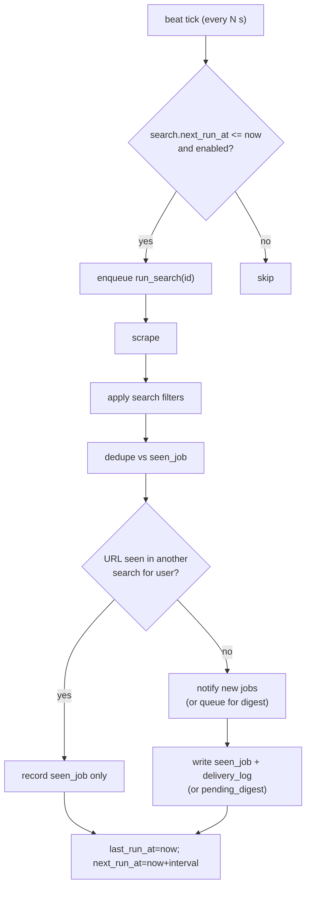

# Module: Worker & Scheduler

**Path:** `backend/app/worker/`

Celery provides the scheduler (beat) and the workers. The worker package is
**glue only** — it calls services; business logic lives in services.

## Pieces

- `celery_app.py` — the Celery application + config (broker/result backend from
  settings).
- `schedule.py` — beat ticks: enqueue due searches and flush digest queues.
- `tasks.py` — `run_search(search_id)`, `flush_due_digests()`, and `apply_to_job` (queued live auto-apply).

## Due-based scheduling with catch-up

Beat runs every `SCHEDULER_TICK_SECONDS`. On each tick (and once on startup) it:

1. Selects searches where `enabled = true AND next_run_at <= now` and enqueues
   `run_search` for each.
2. Flushes digest queues whose `digest_interval_seconds` has elapsed.

Each search carries `interval_seconds`, `last_run_at`, `next_run_at`.

After a run, the worker sets `last_run_at = now` and
`next_run_at = now + interval_seconds`.

**Catch-up:** if the host was asleep/offline, many searches will be overdue on
the next tick. They each run **once** (not once per missed interval) because
`next_run_at` is recomputed from *now*, not advanced N times. `SCHEDULER_MAX_CATCHUP`
documents/limits this collapse. Dedup via `seen_job` means a missed window only
delays notifications; nothing is dropped or duplicated.

## Pipeline (`run_search`)

1. Load the search + its source + target (service).
2. Resolve and run the scraper (`get_scraper(source.adapter_key).fetch(ctx)`).
3. Sync job lifecycle: mark `new`/`seen` rows missing from the scrape as `closed`;
   reopen `closed` rows that reappear as `seen`. Applied/archived rows are untouched.
4. Apply the search's `filters` JSON to drop non-matching postings.
5. Dedupe postings against `seen_job` for that search (by `external_id`).
6. Skip notification when the normalized job URL was already seen in any of the
   owner's other searches (cross-search dedup); still persist a `seen_job` row for
   this search so the Jobs feed stays complete.
7. Send remaining new postings via `get_notifier(target.type).send(ctx, new_jobs)`,
   or queue them in `pending_digest` when `notification_mode` is `digest`.
8. Persist `seen_job` rows and `delivery_log` entries (immediate mode only);
   update schedule fields.

A separate beat task `flush_due_digests` sends batched notifications for digest
searches whose interval has elapsed, then clears the queue and sets
`last_digest_at`.

Failures at any external step are caught, logged, and recorded; the worker keeps
running.

## Queued auto-apply

Live submissions from `POST /jobs/{id}/apply` (non–dry-run) are validated in the
API, written to `application_log` with status `queued`, and enqueued as
`apply_to_job`. A Celery worker runs `ApplyService.apply_to_job` with the queued
log id, updates the audit row to `processing` then `submitted` or `failed`, and
marks the job `applied` on success. Preview (`dry_run: true`) still runs
synchronously in the API. Clients poll `GET /application-logs/{id}` until the
log reaches a terminal status.

When a scrape uses the `playwright` adapter, the worker reuses a process-scoped
headless Chromium browser (see [scrapers.md](scrapers.md)). Use the worker Docker
target / `headstart-backend-worker` image in production.

Prometheus metrics for scrape latency, pipeline outcomes, and notification
delivery are recorded here — see [metrics.md](metrics.md).

## Testing

- Integration test drives the full pipeline against scraper fixtures + a fake
  notifier, asserting only-new jobs notify and dedup holds.
- A downtime/catch-up test sets `next_run_at` in the past and asserts a single
  catch-up run.
