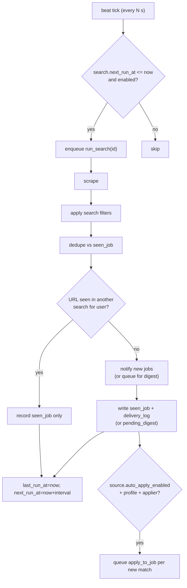

# Module: Worker & Scheduler

**Path:** `backend/app/worker/`

Celery provides the scheduler (beat) and the workers. The worker package is
**glue only** — it calls services; business logic lives in services.

## Pieces

- `celery_app.py` — the Celery application + config (broker/result backend from
  settings).
- `schedule.py` — beat ticks: enqueue due searches, flush digest queues, and
  (when inbox agent is enabled) inbox polling and ghost detection.
- `tasks.py` — `run_search(search_id)`, `flush_due_digests()`, `apply_to_job`,
  `process_inbox_messages`, and `detect_ghosted_applications`.

## Due-based scheduling with catch-up

Beat runs every `SCHEDULER_TICK_SECONDS`. On each tick (and once on startup) it:

1. **Atomically claims** due searches (`enabled = true AND next_run_at <= now`) by
   advancing their `next_run_at` in the same transaction (`FOR UPDATE SKIP LOCKED`
   on Postgres), then enqueues `run_search` for each claimed id. The claim acts as a
   lease: a scrape slower than the tick interval, or an overlapping tick, cannot
   re-enqueue the same search and double-notify.
2. Flushes digest queues whose `digest_interval_seconds` has elapsed (each search is
   locked while flushing, so overlapping ticks don't double-send a digest). A notifier
   failure on one search is isolated: the tick logs it and continues, and each
   successful flush commits before the next search so a later failure cannot roll
   back already-delivered digests.

Each search carries `interval_seconds`, `last_run_at`, `next_run_at`.

After a run, the worker sets `last_run_at = now` and
`next_run_at = now + interval_seconds`.

**Catch-up:** if the host was asleep/offline, many searches will be overdue on
the next tick. They each run **once** (not once per missed interval) because
`next_run_at` is recomputed from *now* (`next_run_from` in
`services/scheduling.py`), not advanced N times, so many missed intervals
collapse into a single catch-up run. Dedup via `seen_job` means a missed window
only delays notifications; nothing is dropped or duplicated.

## Pipeline (`run_search`)

1. Load the search + its source + target (service).
2. Resolve and run the scraper (`get_scraper(source.adapter_key).fetch(ctx)`).
3. Sync job lifecycle: mark `new`/`seen` rows missing from the scrape as `closed`;
   reopen `closed` rows that reappear as `seen`. Applied/archived rows are untouched.
4. Apply the search's `filters` JSON to drop non-matching postings.
5. Dedupe postings against `seen_job` for that search (by `external_id`).
6. Skip notification when the normalized job URL was already seen in any of the
   owner's other searches (cross-search dedup); still persist a `seen_job` row for
   this search so the Jobs feed stays complete.
7. Send remaining new postings via `get_notifier(target.type).send(ctx, new_jobs)`,
   or queue them in `pending_digest` when `notification_mode` is `digest`.
8. Persist `seen_job` rows and `delivery_log` entries (immediate mode only);
   update schedule fields.
9. When `source.auto_apply_enabled`, the user has an application profile, and the
   adapter supports apply: queue a live `apply_to_job` Celery task for each new
   match (including jobs skipped for notification by cross-search dedup), until
   the plan's rolling 24h live-apply volume cap is reached. Uses the profile
   cover-letter template (no per-job override). Respects existing
   `application_log` in-flight rows.

A separate beat task `flush_due_digests` sends batched notifications for digest
searches whose interval has elapsed, then clears the queue and sets
`last_digest_at`. Flushes are per-search: one bad target cannot abort the tick or
undo another search's already-sent digest bookkeeping.

Failures at any external step are caught, logged, and recorded; the worker keeps
running.

## Queued auto-apply

Live submissions from `POST /jobs/{id}/apply` (non–dry-run) are validated in the
API, written to `application_log` with status `queued`, and enqueued as
`apply_to_job`. The same queue path runs from the pipeline when
`source.auto_apply_enabled` is on and a new match appears during `run_search`
(see step 9 above). Pipeline auto-apply also respects the user's plan
`max_auto_applies_per_day` rolling window (live `application_log` rows only;
manual Apply is uncapped by this limit). A Celery worker runs
`ApplyService.apply_to_job` with the queued log id, updates the audit row to
`processing` then `submitted` or `failed`, sets `seen_job.applied_at` and marks
the job `applied` on success. Preview (`dry_run: true`) still runs synchronously
in the API. Clients poll `GET /application-logs/{id}` until the log reaches a
terminal status.

Every `application_log` row includes baseline tracking metadata in `payload`
(`employer_domain`, `posting` title/company/url) for downstream inbox triage
(Phase 20).

When a scrape uses the `playwright` adapter, the worker reuses a process-scoped
headless Chromium browser (see [scrapers.md](scrapers.md)). Use the worker Docker
target / `headstart-backend-worker` image in production.

Prometheus metrics for scrape latency, pipeline outcomes, and notification
delivery are recorded here — see [metrics.md](metrics.md).

## Ghost detection (dev inbox)

When `INBOX_AGENT_ENABLED=true`, beat also schedules
`detect_ghosted_applications` every `INBOX_GHOST_CHECK_INTERVAL_SECONDS`
(default 3600). The task calls `GhostDetectionService.process_due` to email
self-summaries for applications past `INBOX_GHOST_WINDOW_DAYS` without a
recruiter reply and set `seen_job.ghosted_at`. See [inbox.md](inbox.md).

## Inbox orchestration (dev inbox)

When `INBOX_AGENT_ENABLED=true`, beat also schedules `process_inbox_messages`
every `INBOX_POLL_INTERVAL_SECONDS` (default 300). The task calls
`InboxOrchestrationService.process_due` to:

1. Fetch new mail since the stored UID cursor (`inbox_poll_state.last_polled_uid`,
   bootstrapped from the highest classified UID when unset).
2. Skip unrelated mail via `InboxGateService` (employer domain, thread headers,
   ghost self-mail, optional sender allowlist) — no classifier or DB write.
3. Classify gated messages via `EmailClassificationService` (link application,
   ghost recovery, interview handoff, folder routing).
4. Advance the cursor through classified and ignored messages; classify failures
   retry on the next tick.

The task return payload includes `ignored` (mail skipped by the gate).

Poll batch size is capped by `INBOX_POLL_BATCH_SIZE` (default 50). See
[inbox.md](inbox.md).

## Pending reply auto-send (dev inbox)

When `INBOX_AGENT_ENABLED=true`, beat also schedules `process_pending_replies`
every `INBOX_REPLY_SEND_INTERVAL_SECONDS` (default 60). The task first claims due
rows (`PendingReplyService.claim_due_ids` → `status=sending`) and commits, then
SMTP-sends in a second transaction (`process_claimed`) so overlapping ticks /
`acks_late` redelivery cannot double-send. See [inbox.md](inbox.md).

## Testing

- Integration test drives the full pipeline against scraper fixtures + a fake
  notifier, asserting only-new jobs notify and dedup holds.
- A downtime/catch-up test sets `next_run_at` in the past and asserts a single
  catch-up run.
