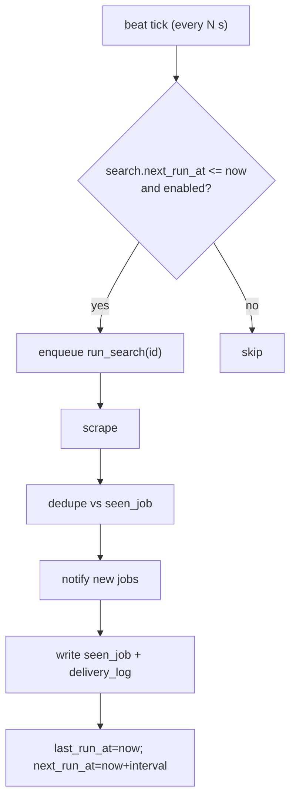

# Module: Worker & Scheduler

**Path:** `backend/app/worker/`

Celery provides the scheduler (beat) and the workers. The worker package is
**glue only** — it calls services; business logic lives in services.

## Pieces

- `celery_app.py` — the Celery application + config (broker/result backend from
  settings).
- `schedule.py` — the beat tick: find due searches and enqueue them.
- `tasks.py` — `run_search(search_id)`: the per-search pipeline.

## Due-based scheduling with catch-up

Beat runs every `SCHEDULER_TICK_SECONDS`. On each tick (and once on startup) it:

1. Selects searches where `enabled = true AND next_run_at <= now`.
2. Enqueues `run_search` for each.

Each search carries `interval_seconds`, `last_run_at`, `next_run_at`.

After a run, the worker sets `last_run_at = now` and
`next_run_at = now + interval_seconds`.

**Catch-up:** if the host was asleep/offline, many searches will be overdue on
the next tick. They each run **once** (not once per missed interval) because
`next_run_at` is recomputed from *now*, not advanced N times. `SCHEDULER_MAX_CATCHUP`
documents/limits this collapse. Dedup via `seen_job` means a missed window only
delays notifications; nothing is dropped or duplicated.

## Pipeline (`run_search`)

1. Load the search + its source + target (service).
2. Resolve and run the scraper (`get_scraper(source.adapter_key).fetch(ctx)`).
3. Dedupe postings against `seen_job` for that search.
4. Send new postings via `get_notifier(target.type).send(ctx, new_jobs)`.
5. Persist `seen_job` rows and `delivery_log` entries; update schedule fields.

Failures at any external step are caught, logged, and recorded; the worker keeps
running.

## Testing

- Integration test drives the full pipeline against scraper fixtures + a fake
  notifier, asserting only-new jobs notify and dedup holds.
- A downtime/catch-up test sets `next_run_at` in the past and asserts a single
  catch-up run.
